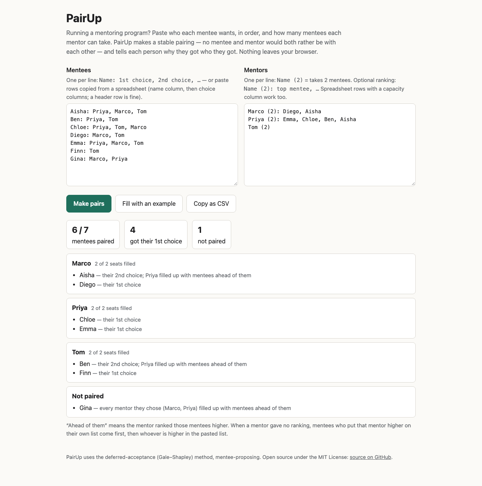

# PairUp

Stable mentor–mentee matching from ranked choices, on one page. Paste your mentees' ranked mentor choices and each mentor's capacity; PairUp returns a **stable** pairing (no mentee and mentor would both rather be with each other) and tells every mentee why they got their match, or why they weren't paired.

**Live:** https://pairup.waitlab.workers.dev — nothing you paste leaves your browser.



## Input

```
Mentees                        Mentors
Aisha: Priya, Marco, Tom       Marco (2): Diego, Aisha
Ben: Priya, Tom                Priya (2): Emma, Chloe, Ben, Aisha
Gina: Marco, Priya             Tom (2)
```

Rows copied from a spreadsheet or a form's CSV export work too: a header row marks the name column, choice columns, timestamp/e-mail columns (ignored) and a capacity column. Mentor rankings are optional.

## Run

```sh
cd public && python3 -m http.server 8799   # open http://localhost:8799
node test.mjs                              # tests, Node 18+
npx wrangler deploy                        # deploy to Cloudflare Workers
```

## How it works

Mentee-proposing deferred acceptance (Gale–Shapley) with mentor capacities. See [`devpost/spec.md`](devpost/spec.md).

## Planning docs

Made with the Devpost *Build With AI: Basics* Skill Pack: [scope](devpost/scope.md) · [PRD](devpost/prd.md) · [spec](devpost/spec.md) · [checklist](devpost/checklist.md).

## How this was built

An AI coding agent (Claude Code) chose the idea, wrote the code, tests and planning docs, and deployed the page, working unattended. The entrant asked for a small, useful entry to this hackathon and decides whether and how to submit it.

## License

[MIT](LICENSE)
